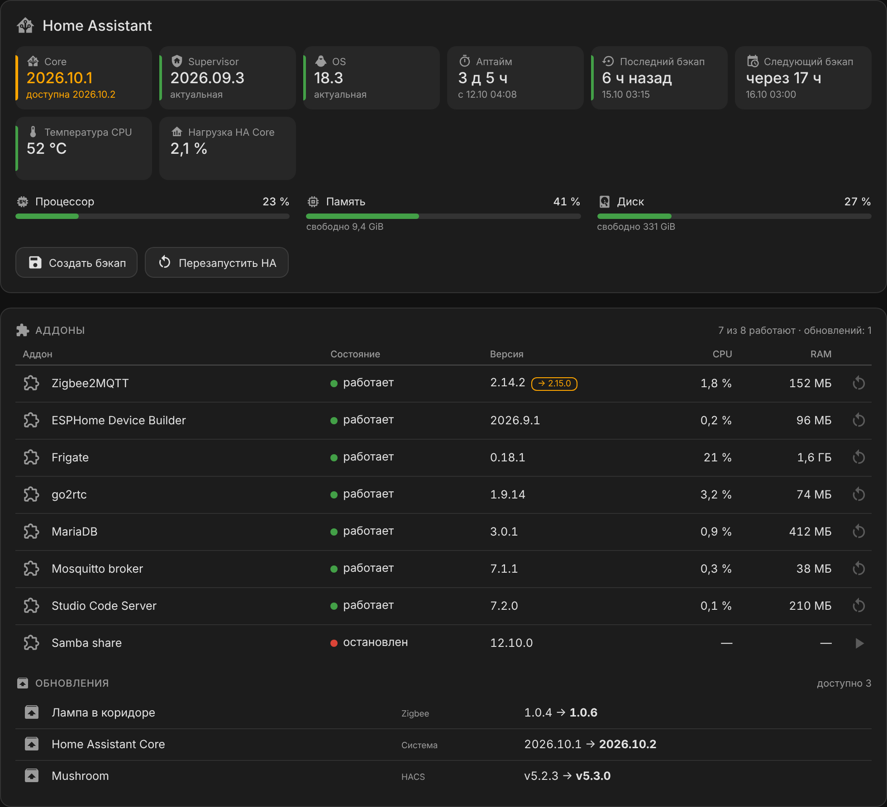
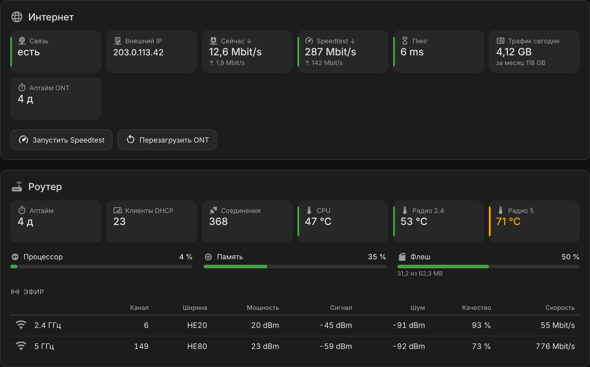
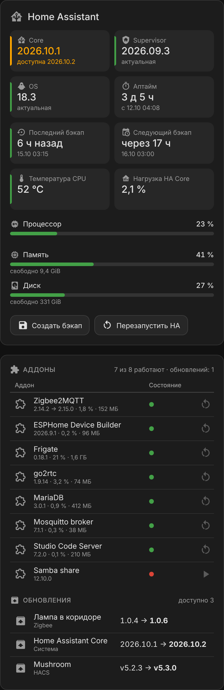

# System Status Card

[](https://hacs.xyz/)
[](https://github.com/Lordhmen/system-status-card/releases)
[](https://github.com/Lordhmen/system-status-card/actions/workflows/validate.yml)

Карточка Lovelace для Home Assistant: **сводка состояния системы** в одной карточке —
плитки с порогами, шкалы, аддоны, обновления, таблица и кнопки с подтверждением.



Сестринский проект [devices-table-card](https://github.com/Lordhmen/devices-table-card) и
[stats-table-card](https://github.com/Lordhmen/stats-table-card): тот же стиль, один JS-файл без зависимостей.

## Возможности

- **Плитки** (`tiles`): версия из `update.*` с пометкой «доступна X», «7 ч назад» / «через 16 ч» / аптайм «3 д 5 ч»,
  `binary_sensor` как «есть / нет связи», числа с порогами — цветная полоска слева и цвет значения.
- **Шкалы** (`meters`): процент с порогами, максимум числом или другой сущностью («31 из 62 MB»).
- **Аддоны** (`addons`): все аддоны Supervisor с иконками, состоянием, версией, CPU и RAM; перезапуск или запуск
  с подтверждением, кнопка «→ новая версия» открывает стандартный диалог обновления HA (с бэкапом).
- **Обновления** (`updates`): все `update.*`, для которых есть новая версия — система, аддоны, HACS, прошивки Zigbee/ESPHome.
- **Таблица** (`table`): сущности строками и колонками, пороги по колонкам; на телефоне переворачивается.
- **Кнопки** (`buttons`): `button.*`, скрипты или любая служба; подтверждение перед действием, опасные подсвечиваются.
- Клик по плитке, шкале или ячейке открывает карточку сущности.
- Тёмная и светлая темы через CSS-переменные HA, адаптивная вёрстка.

| Сеть и роутер | Телефон |
|---|---|
|  |  |

Все скриншоты сняты с демо-страницы [`docs/demo.html`](docs/demo.html) на вымышленных данных.

## Установка

### HACS

1. HACS → ⋮ → **Пользовательские репозитории**.
2. Репозиторий `https://github.com/Lordhmen/system-status-card`, тип **Dashboard**.
3. Установите **System Status Card** и обновите страницу с очисткой кэша (Ctrl+F5).

### Вручную

1. Скачайте `system-status-card.js` со страницы [релизов](https://github.com/Lordhmen/system-status-card/releases)
   и положите в `/config/www/system-status-card.js`.
2. **Настройки → Панели → ⋮ → Ресурсы → Добавить ресурс**: URL `/local/system-status-card.js?v=0.1.3`, тип **JavaScript-модуль**.

## Пример

```yaml
type: custom:system-status-card
title: Home Assistant
icon: mdi:home-assistant
sections:
  - type: tiles
    items:
      - entity: update.home_assistant_core_update
        name: Core
      - entity: sensor.backup_last_successful_automatic_backup
        name: Бэкап
        format: ago
        warn_after: 26
        bad_after: 50
      - entity: sensor.system_monitor_processor_temperature
        name: Темп. CPU
        warn: 70
        bad: 85
  - type: meters
    items:
      - entity: sensor.system_monitor_memory_usage
        name: Память
        secondary: sensor.system_monitor_memory_free
        secondary_prefix: свободно
  - type: addons
  - type: updates
  - type: buttons
    items:
      - name: Создать бэкап
        icon: mdi:content-save
        service: backup.create_automatic
        confirm: Создать бэкап сейчас?
```

Больше примеров: [`examples/server.yaml`](examples/server.yaml), [`examples/network.yaml`](examples/network.yaml).

## Параметры карточки

| Параметр | По умолчанию | Описание |
|---|---|---|
| `title`, `icon` | — | Заголовок и иконка (без них шапки нет) |
| `sections` | — | Список секций (обязательно) |
| `actions` | `true` | Кнопки и действия в аддонах (видны только администраторам) |
| `time_zone` | часовой пояс HA | Для дат |

У любой секции есть `title` и `icon` — подзаголовок секции.

### `tiles` — плитки

`items` — список плиток:

| Ключ | Описание |
|---|---|
| `entity` | Сущность. Для `update.*` формат `version` выбирается сам, для `binary_sensor.*` — `binary` |
| `name`, `icon` | Подпись и иконка |
| `format` | `version`, `binary`, `ago` («7 ч назад»), `in` («через 16 ч»), `since` (сколько прошло с момента — аптайм), `duration` (значение в `s` / `min` / `h` / `d`) |
| `warn`, `bad`, `below` | Пороги для чисел; `below: true` — плохо, когда значение меньше |
| `warn_after`, `bad_after` | Для `ago`: пороги возраста в часах |
| `decimals`, `factor`, `unit` | Округление, множитель и единица (иначе — как форматирует HA) |
| `attribute` | Брать атрибут вместо состояния |
| `on_text`, `off_text`, `ok_state` | Для `binary`: подписи и «хорошее» значение (`on`, для атрибута — `true`; можно `false`) |
| `fail_level` | Для `binary`: цвет «плохого» значения — `bad` (по умолчанию) или `warn` |
| `value`, `sub` | Плитка без сущности: свой текст (например, IP со ссылкой через `tap_action: {action: url}`) |
| `secondary`, `secondary_prefix`, `secondary_decimals` | Вторая строка из другой сущности (время — «35 мин назад») |
| `secondary_attribute` | Вторая строка из атрибута той же сущности |
| `tap_action` | `navigate` / `url` / `none`, иначе открывается карточка сущности |

`min_width` у секции — минимальная ширина плитки (по умолчанию 132 px).

### `meters` — шкалы

| Ключ | Описание |
|---|---|
| `entity`, `name`, `icon` | Сущность (процент или значение), подпись, иконка |
| `max` | Число или сущность — максимум (по умолчанию 100) |
| `free` | `true` — сущность показывает свободное, шкала — занятое |
| `warn`, `bad` | Пороги в процентах (по умолчанию 75 и 90) |
| `secondary`, `secondary_prefix` | Подпись под шкалой из другой сущности |

### `addons` — аддоны

Список берётся из Supervisor API (нужны права администратора), CPU и RAM — оттуда же раз в минуту.
Без прав администратора — из сущностей интеграции Supervisor (`binary_sensor.*_running`, `update.*`).

| Ключ | Описание |
|---|---|
| `include`, `exclude` | Маски по slug или имени (`core_*`, `Samba*`) |
| `show_stopped` | `false` — скрыть остановленные |
| `stats` | `false` — без CPU и RAM |

### `updates` — обновления

| Ключ | Описание |
|---|---|
| `include`, `exclude` | Маски `entity_id` |
| `exclude_platforms` | Не показывать платформы, например `[hacs]` |

### `table` — таблица

`columns` — подписи колонок (строка или объект с `name` и любыми ключами плитки: `decimals`, `warn`, `bad`, `below`,
`format: plain` — показать состояние как есть). `rows` — строки: `name`, `icon`, `cells` — сущности по колонкам
(строка или объект с `entity` и своими ключами).

### `buttons` — кнопки

| Ключ | Описание |
|---|---|
| `entity` | `button.*` / `input_button.*` — нажать, `script.*` / `scene.*` — запустить, `automation.*` — выполнить |
| `service`, `data`, `target` | Вместо `entity` — любая служба |
| `navigate` | Вместо действия — перейти на страницу |
| `name`, `icon`, `danger` | Подпись, иконка, красная подсветка |
| `confirm` | Текст подтверждения; `false` — без подтверждения |
| `done_text` | Уведомление после выполнения |
| `admin` | `false` — показывать и не администраторам |

## Разработка

```bash
node --check system-status-card.js
node --test tests/*.test.mjs
python3 -m http.server   # затем открыть /docs/demo.html — демо без Home Assistant
                         # параметры: ?view=server|network, ?theme=light, ?width=380
```

Релиз собирается автоматически: поднимите `SSC_VERSION` в `system-status-card.js`, допишите `CHANGELOG.md` и отправьте в `main`.

## Лицензия

MIT
